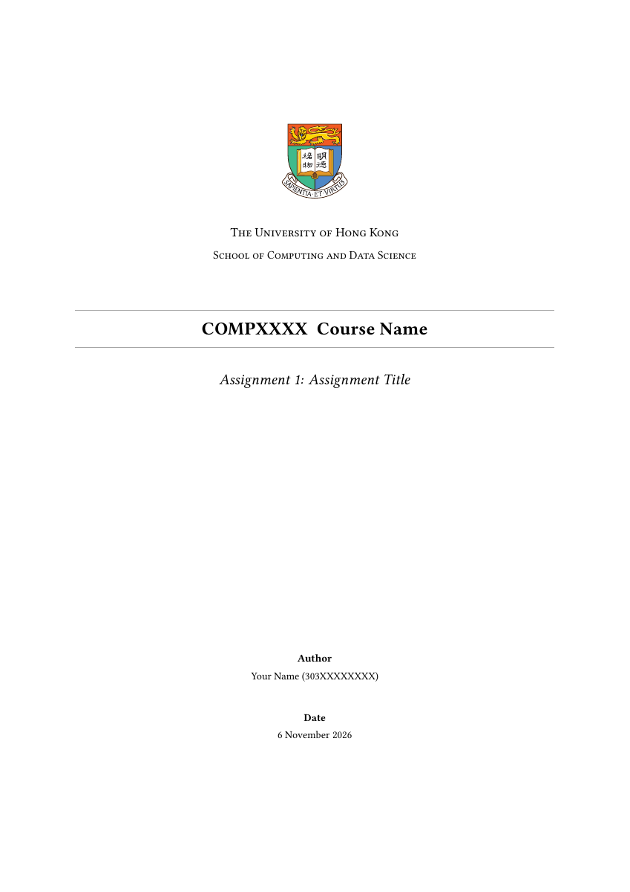

# HKU CDS 简洁课程作业模板

以 Guanying Chen 的 HKU 博士论文 LaTeX 项目为基础视觉参考，独立使用 `article` 编写；封面按提供的简洁课程作业样例调整：校徽与学院名称居中、两条细线夹住课程标题、斜体作业标题，下方只保留作者和日期。

学院名称使用 **School of Computing and Data Science**。这是个人制作的非官方模板；如课程有明确格式要求，以课程要求为准。



[查看完整 PDF 示例](main.pdf)

## 快速使用（Overleaf）

1. 在 GitHub 点击 **Code → Download ZIP** 下载项目；在 Overleaf 选择 **New Project → Upload Project** 上传 ZIP。
2. 主文件选择 `main.tex`，编译器选择 **pdfLaTeX**。
3. 修改 `main.tex` 顶部的课程代码、课程名称、作业编号、标题、姓名、学号及日期。
4. 将示例题目、解答、结果、图框和参考文献替换为自己的内容。
5. 点击 Recompile。示例结果为虚构数据，不是可直接提交的作业答案。

## 文件

- `main.tex`：个人信息与正文，通常只需修改此文件。
- `hku-cds-assignment.sty`：版式设置。
- `assets/HKUcolour.pdf`：参考仓库内的港大校徽。
- `main.pdf`：由本套源码实际编译的示例预览。
- `NOTICE.txt`：来源与原项目许可说明。
- `preview.png`：首页效果预览。

## 两种版式

默认 `\coverpagetrue` 使用独立封面。短作业可改为 `\coverpagefalse`，把信息放在正文第一页顶部。

默认 A4、11 pt、25 mm 页边距、1.15 倍行距。正文页眉显示课程代码、作业编号及学号，页脚显示“当前页 / 正文总页数”。封面不计入正文页数。

正文用 `\question{题目标题}` 自动编号。使用 `\subsection*{(a) ...}` 写小问。报告型作业可直接使用 `\section{Introduction}`，并在导言区添加 `\renewcommand{\thesection}{\arabic{section}}` 恢复普通节编号。无需目录、摘要或诚信声明；如课程要求，可自行添加规定文本。

## 中文与小组作业

- 默认正文为英文。写中文时，取消 `main.tex` 中 `\usepackage[UTF8,scheme=plain]{ctex}` 的注释，并切换至 **XeLaTeX**。
- 小组作业可把姓名字段写为 `Alice / Bob`，学号字段写为对应学号；需要逐行列出成员时，直接在样式文件封面的 `Author` 下方增加作者行，并将标签改为 `Authors`。
- LaTeX 文本中的 `&`、`%`、`_` 等特殊字符要写成 `\&`、`\%`、`\_`。

## 本地编译

安装 TeX Live 或 MiKTeX 后，在模板目录运行两次：

```text
pdflatex -interaction=nonstopmode -halt-on-error main.tex
pdflatex -interaction=nonstopmode -halt-on-error main.tex
```

也可使用 `latexmk -pdf main.tex`。中文配置改用 `latexmk -xelatex main.tex`。
参考文献默认使用 `thebibliography`，无需运行 BibTeX；长报告可自行改为 `.bib` 管理。
随包 PDF 使用 Tectonic（XeTeX 引擎）实际编译生成，并检查了三页版面。

## 来源

- 参考项目：https://github.com/guanyingc/HKU-PhD-Thesis-LaTex
- 学院名称：https://www.cds.hku.hk/
- 校徽取自参考项目 `Classes_final/HKUcolour.pdf`，保留原图。配色仅为本模板的排版选择，不代表官方视觉规范。
